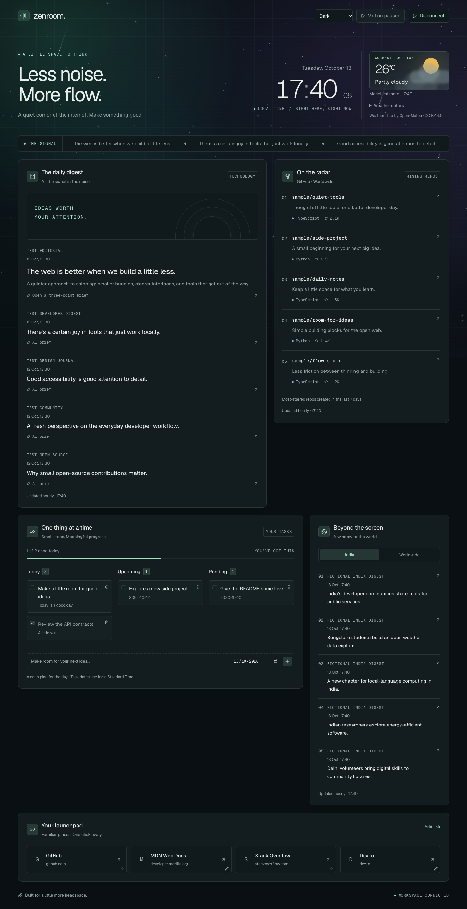

# Developer Zen Room



*Preview from browser tests with fictional fixture data. Your installation starts with your own account and feeds.*

A quiet second-monitor dashboard for developers. Read tech, India and world news; get three-point article summaries; find rising GitHub repositories; manage tasks and quick links. Includes opt-in local weather with condition-based effects, a clock, headline ticker, Dark/Light/Eye Comfort themes, ambient pause and reduced-motion support. Cards use a responsive, non-resizable grid.

Built with **Next.js and JavaScript/JSX**, Tailwind CSS, Framer Motion, Django REST Framework, PostgreSQL, Celery and Redis. Django handles provider calls and credentials; Redis caches hourly feeds and atomically enforces summary/weather quotas. Next.js uses a nonce-based Content Security Policy and dynamic rendering.

[User guide](docs/USER_GUIDE.md) · [API](docs/API.md) · [Contributing](CONTRIBUTING.md) · [Security](SECURITY.md)

Original project code, including the original Canvas 2D galaxy effect, is under [MIT](LICENSE). Dependencies and external content retain their own terms; see [third-party notices](THIRD_PARTY_NOTICES.md).

Weather uses [Open-Meteo](https://open-meteo.com/) without an API key. Connect your workspace, choose **Use my location**, and allow browser location access. Weather sits beside the main clock; expand **Weather details** for humidity, wind and refresh controls. Current model-based conditions refresh every 15 minutes; location requires HTTPS or localhost. The free endpoint is for non-commercial use; see [terms](https://open-meteo.com/en/terms).

## Run locally

### 1. Get the code

Install Git and Docker with Compose v2, and start your Docker engine (Docker Desktop, or a compatible engine such as Colima on macOS). Use a terminal with `docker compose` available.

```bash
git clone https://github.com/itsfarheen15/ZenRoom.git
cd ZenRoom
```

Python 3 is needed only for the configuration helper below; the application runtimes run in containers.

### 2. Create your private configuration

Create configuration once from the repository root. **If `.env` already exists, skip this block** and edit only the keys you need; never overwrite it:

```bash
python3 - <<'PY'
from pathlib import Path
import secrets
text = Path('.env.example').read_text()
text = text.replace('replace-with-a-random-secret', secrets.token_urlsafe(50))
text = text.replace('replace-with-a-random-password', secrets.token_urlsafe(32))
with Path('.env').open('x') as output:
    output.write(text)
Path('.env').chmod(0o600)
PY
```

Without Python, copy `.env.example` to `.env` and replace both `replace-with-a-random-*` placeholders with separate strong random secrets from a password manager. Keep an existing `.env` intact.

### 3. Add your own provider keys

Edit root `.env` in your editor:

| Feature | What you supply |
|---|---|
| News | Your `FREENEWS_API_KEY` from [FreeNewsApi.io](https://www.freenewsapi.io/). This is the sole news provider. |
| AI summaries | Your `GEMINI_API_KEY` from [Google AI Studio](https://aistudio.google.com/api-keys). Choose a structured-output model available to your account with `GEMINI_MODEL`. |
| GitHub repositories | Optional `GITHUB_TOKEN` for higher public API quota. Private-repository permissions are unnecessary. |
| Tasks, links, themes and clock | No external provider account needed. |

Keep Gemini on the Free tier if you want to avoid usage charges. Check [current model availability, quotas and data-use terms](https://ai.google.dev/gemini-api/docs/pricing); free-tier content may be used to improve Google's products. The configured model is `gemini-3.5-flash-lite`; confirm its availability and free-tier quota in your account. There is no paid-model fallback. Hosting and external services have their own terms and limits.

You can leave provider keys blank to try local tasks and links. Missing keys produce an unavailable state, not demo content. The GitHub widget can use unauthenticated public REST search. **The GitHub token, Gemini key and news key are not the Django workspace token.**

### 4. Start all six services

```bash
docker compose up --build
```

Compose starts PostgreSQL and Redis, applies migrations, then starts Django, Celery worker, one Beat scheduler and Next.js. Initial feed loading can take a few minutes. Keep this command running, or use `docker compose up -d --build` for background mode. Stop older servers using ports 3000 or 8000 first.

### 5. Create your account and connect

In another terminal at the repository root:

```bash
docker compose exec backend python manage.py createsuperuser --username zen
docker compose exec backend python manage.py drf_create_token zen
```

Choose your own password when prompted. `zen` is an example username: if you change it, use the same username in both commands. Existing users should skip account creation and request a token for their actual username.

Open [localhost:3000](http://localhost:3000), select **Connect workspace**, and paste the Django token from the second command. Treat this token like a password. Django exchanges it for a seven-day HttpOnly session cookie; refreshing restores the workspace. Disconnect invalidates that session and clears private frontend caches. Provider keys and API tokens do not go into browser storage.

Manage records at [Django Admin](http://localhost:8000/admin/) with the account username/password. Admin manages records; Django migrations manage the schema. For additional users, use Admin to create separate active accounts, keep staff/superuser unchecked unless needed, and issue each account its own Django token. Tasks and links are owner-isolated.

## Environment Variables

Use root `.env`; it is ignored by Git and supplied only to Python services. Never put provider keys in `NEXT_PUBLIC_*` variables.

| Variable | Required / default | Purpose |
|---|---|---|
| `DJANGO_SECRET_KEY` | Required; generate above | Django signing secret |
| `DJANGO_DEBUG` | `true` locally | Admin static assets and development diagnostics; disable in production |
| `POSTGRES_DB` | `developer_zen` | Database name |
| `POSTGRES_USER` | `zen` | Database role |
| `POSTGRES_PASSWORD` | Required; generate above | PostgreSQL password |
| `POSTGRES_HOST` | `127.0.0.1` for native tools | Compose overrides to `db` |
| `POSTGRES_PORT` | `5432` | Host PostgreSQL port; Compose Python services always use internal 5432 |
| `REDIS_CACHE_URL` | `redis://127.0.0.1:6379/1` for native tools | Compose overrides to `redis://redis:6379/1` |
| `CELERY_BROKER_URL` | `redis://127.0.0.1:6379/0` for native tools | Compose overrides to `redis://redis:6379/0` |
| `GITHUB_TOKEN` | Optional; empty | Higher GitHub API quota; no private-repository access needed |
| `FREENEWS_API_KEY` | Required for news | All three news categories |
| `GEMINI_API_KEY` | Required for summaries | Server-side Gemini SDK |
| `GEMINI_MODEL` | `gemini-3.5-flash-lite` | Structured-output model |
| `NEXT_PUBLIC_DJANGO_API_URL` | `http://localhost:8000/api` | Browser-reachable URL; do not use the container hostname `backend` |

`REDIS_TEST_CACHE_URL` is an optional integration-test override (default Redis database 15). Tests clear it; never point it at application data. It is not required in `.env`.

Compose reads root `.env` and overrides Python service database/broker hosts with container names. `frontend/.env.example` is only for optional host-side frontend development. `ALLOWED_HOSTS`, allowed origins and cookie policy currently live in `backend/config/settings.py`; they are not configurable through undocumented environment variables.

After changing keys, run `docker compose up -d --build` to recreate affected services. Worker startup queues feed refreshes. If a database volume already exists, changing `POSTGRES_PASSWORD` in `.env` alone does not change the stored database password; retain the existing value or rotate the database role password deliberately.

## Use and maintain your installation

The [user guide](docs/USER_GUIDE.md) covers everyday use, troubleshooting, backups and updates. [API and data behavior](docs/API.md) explains sessions, caching, India-topic filtering and summarizer limits.

- News is ranked by recency, not popularity. India means stories about India, regardless of publisher location. Bounded lexical filtering can miss stories; fewer than five results is valid.
- GitHub shows the most-starred non-fork, non-archived repositories created in the past seven days. This approximates rising projects, not GitHub's exact Trending page.
- Hourly jobs cache fresh data for one hour and retain last-good data for 24 hours. Feed requests only read cache. The UI distinguishes stale data, empty results and errors.
- FreeNewsApi calls share a one-per-second Redis gate. Normal hourly news work is bounded to at most 1,200 requests/day before retries or manual refreshes. Confirm your account quota and avoid repeated refreshes. The documented India title search returned HTTP 500 in the last live check; a bounded global scan remains the same-provider fallback.

## Development and deployment

See [Contributing](CONTRIBUTING.md) for checks and local development, and [Deployment](docs/DEPLOYMENT.md) for production requirements. The supplied Compose file runs development servers. The [Checks workflow](.github/workflows/checks.yml) runs backend tests and frontend lint/build/browser tests without provider secrets. Hosted deployments and backups need separate setup.


## License and credits

[MIT](LICENSE) covers original Developer Zen Room code and documentation. Dependencies, fonts and provider content retain their respective terms; see [THIRD_PARTY_NOTICES.md](THIRD_PARTY_NOTICES.md). Keep publisher names and original article links. This repository's license does not grant rights to republish news articles or bypass provider limits.
