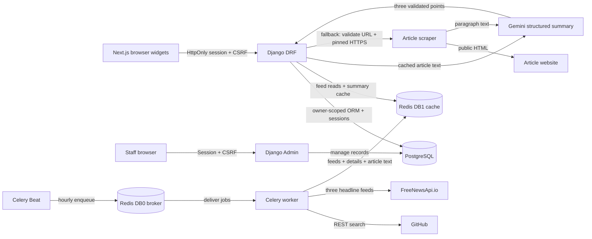

# Connected project map

Start: [rules](../AGENTS.md) → [memory](../MEMORY.md) → this map → source/tests. Human operation: [README](../README.md). Past decisions: [history](HISTORY.md).

[Interactive runtime overview](architecture.html) · [editable Archify source](architecture.json). The overview groups provider/cache paths; the complete logical flow is below. Both describe local development, not a deployed environment.



## Documentation routes

- New users: [README](../README.md) → [user guide](USER_GUIDE.md).
- API consumers/operators: [API](API.md), [deployment](DEPLOYMENT.md), [security](../SECURITY.md).
- Contributors: [contribution guide](../CONTRIBUTING.md), rulebook/memory/history, source table below.
- Maintainers: [publication checklist](MAINTAINERS.md), [MIT license](../LICENSE), [third-party notices](../THIRD_PARTY_NOTICES.md). The current tree uses an original MIT light tunnel; review legacy Git history before publication.
- [Hero image](hero.png) uses fictional browser-test fixtures. `.github/ISSUE_TEMPLATE/` and the PR template guide redacted reports.

The original Canvas 2D effect lives inside the browser node. The 2026-10-13 replacement changes no service/edge topology; the existing generated runtime overview remains applicable.

CI: [Checks workflow](../.github/workflows/checks.yml) → Python mocked unit tests/migration check + frontend lint/build/mocked Chrome tests. It does not deploy or contact providers.

## Source ownership and change impact

| Concern | Source | Verification / related files |
|---|---|---|
| Startup/network/volumes | [Compose](../docker-compose.yml), [Python image](../backend/Dockerfile), [Node image](../frontend/Dockerfile) | README, `.env.example`; validate config + boot six services |
| Environment/CORS/auth/queues | [settings](../backend/config/settings.py), [Celery app](../backend/config/celery.py) | `config/test_settings.py`, `integration_test_settings.py` |
| Durable records | [models](../backend/dashboard/models.py), [serializers](../backend/dashboard/serializers.py), [views](../backend/dashboard/views.py) | migrations, [tests](../backend/dashboard/tests.py), task/link widgets |
| Database management | [admin](../backend/dashboard/admin.py), [root URLs](../backend/config/urls.py) | staff login, model change lists; migrations own schema |
| FreeNewsApi transport/rate gate | [provider](../backend/feeds/freenews.py) | Redis atomic1/sec gate; details + article text cache; tests |
| External feeds | [tasks](../backend/feeds/tasks.py), [cache](../backend/feeds/cache.py) | [feed tests](../backend/feeds/tests.py); settings schedule, provider docs |
| Feed/summary routes | [views](../backend/feeds/views.py), [URLs](../backend/feeds/urls.py) | API contracts, frontend API client, feed tests |
| Scraper + Gemini | [summarizer](../backend/feeds/summarizer.py) | SSRF/redirect/structured-output/quota tests; env and requirements |
| Client transport/auth | [API module](../frontend/src/lib/api.jsx), [session exchange](../backend/dashboard/session.py) | [real browser test](../frontend/tests/session-live.spec.js), dashboard tests; HttpOnly cookie, CSRF, cache isolation |
| India subject relevance | [bounded filtering](../backend/feeds/india.py) | [tests](../backend/feeds/test_india.py), provider title search / global scan fallback, new cache namespace |
| Page composition/style | [page](../frontend/src/app/page.jsx), [layout](../frontend/src/app/layout.jsx), [CSS](../frontend/src/app/globals.css) | dashboard-frame, local fonts, responsive browser tests |
| Theme / readable text | [theme preference](../frontend/src/lib/use-theme.js), [CSS tokens](../frontend/src/app/globals.css), [frame](../frontend/src/components/dashboard-frame.jsx) | localStorage preference only; contrast/dialog/mobile/persistence browser tests |
| Ambient rendering | [frame](../frontend/src/components/dashboard-frame.jsx), [original light tunnel](../frontend/src/components/light-tunnel.jsx), [motion hook](../frontend/src/lib/use-reduced-motion.js) | Canvas 2D; gentle parallax/falling stars, pause/reduced-motion/cleanup; browser tests |
| News + modal | [news](../frontend/src/components/news.jsx), [modal](../frontend/src/components/modal.jsx), [ticker](../frontend/src/components/live-ticker.jsx) | summary endpoint, focus restoration, loading/error states |
| Tasks/links/repos/clock | [components directory](../frontend/src/components) | [browser tests](../frontend/tests/dashboard.spec.js) |
| Lint dependency workaround | [package override](../frontend/package.json), [compatibility test](../frontend/tooling/next-root-dirs.test.mjs) | Next16.4 plugin globSync → tinyglobby; audit, tooling test, lint/build |
| JS tooling | [package](../frontend/package.json), [alias config](../frontend/jsconfig.json), [Next config](../frontend/next.config.js) | lockfile, ESLint, Playwright config; no app TS |

## Graph maintenance

Stable runtime IDs: `browser`, `api`, `db`, `gemini`, `redis`, `worker`, `beat`, `feeds`. Update source links and logical Mermaid whenever behavior changes. The Archify overview collapses broker/cache into one Redis node; worker writes are detailed above.

With the Archify skill installed, validate and regenerate from repository root:

```bash
node ~/.agents/skills/archify/bin/archify.mjs validate architecture docs/architecture.json --quality showcase --json
node ~/.agents/skills/archify/bin/archify.mjs deliver architecture docs/architecture.json docs/architecture.html --quality showcase --json
node ~/.agents/skills/archify/bin/archify.mjs visual-check docs/architecture.html --json
```

Do not claim graph/browser validation without a successful receipt. If Archify is unavailable, keep this Markdown graph current and mark the HTML stale until regenerated.

Receipt path metadata was redacted on 2026-10-13 for publication; original verification hashes/results are unchanged. Generated HTML was not edited.

## Graph evidence (2026-10-12)

[Delivery receipt](architecture.delivery.json): architecture showcase 9/9 checks, zero errors/warnings; includes exact specification/artifact hashes and sizes. [Automated browser receipt](architecture.visual-check.json): passed. Perceptual review: current 1440×900 dark screenshot inspected, readable nodes/routes without overlap. Graph updated for HttpOnly sessions and CSRF; no generated HTML hand edits.
